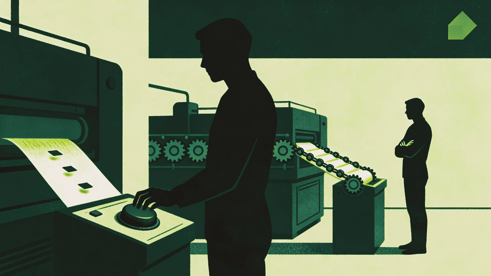
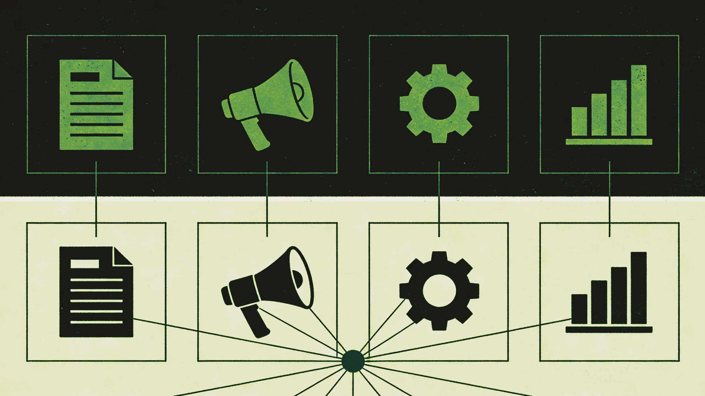

Tu feed de LinkedIn está lleno de gente diciéndote que la IA agéntica va a transformar tu departamento de marketing. La mayoría vende algo. Este no es ese artículo.

Lo que viene es una definición práctica de la IA agéntica y una mirada honesta a dónde puede ayudar de forma realista a un equipo de marketing B2B, incluidos los puntos en los que la demo todavía va por delante del día a día. Si diriges un equipo de marketing de tres a ocho personas, sin nadie dedicado a IA ni a tecnología y con un presupuesto de entre 200.000 € y 1 M€ (220.000 $ y 1,1 M$), esto está escrito específicamente para ti.

## Empieza por las palabras, porque importan

El término "IA agéntica" se usa para hablar de cosas muy distintas, y eso es parte del problema.

La IA generativa crea contenido en respuesta a un prompt: escribes algo, te devuelve algo y ahí se acaba la interacción. La IA agéntica va un paso más allá. Un agente es un sistema capaz de fijarse un subobjetivo, ejecutar una secuencia de acciones para alcanzarlo, observar el resultado y corregir el rumbo sin esperar a que le des un prompt en cada paso.

Una herramienta de IA generativa es como un becario muy capaz que necesita instrucciones detalladas para cada tarea. Un sistema agéntico se parece más a un proceso autónomo: le das un objetivo, recorre los pasos y te avisa cuando ha terminado o cuando necesita que intervengas.

En la práctica, esto importa porque casi todo el valor del marketing está en la secuencia de pasos que rodea a cada pieza de contenido: investigación, brief, borrador, ciclo de revisión, publicación, distribución, seguimiento. La IA generativa ayuda con pasos sueltos, mientras que la agéntica puede encargarse de la secuencia.

## Cómo se ve esto de verdad en un equipo de marketing B2B

Repasar una a una cuatro áreas funcionales ayuda a concretar qué es realista hoy.

**Producción de contenido**

Es la aplicación más madura. Un workflow agéntico de contenido podría funcionar así: das el brief de un tema y el agente hace la investigación de keywords, esboza un esquema, genera un borrador completo, lo contrasta con la guía de marca, señala las secciones que hay que revisar y lo deja listo para publicar cuando se aprueba. Una persona sigue en el loop para la revisión y el criterio editorial, pero sin hacer el trabajo mecánico de cada paso.

Para un equipo que produce de cuatro a seis artículos al mes, esto libera una cantidad de tiempo considerable. El cuello de botella pasa de la producción a la calidad editorial, que es donde debería estar tu atención de todas formas.

**Generación de demanda y outreach**

Es un área más compleja y más potente, con más margen para que algo salga mal. Los sistemas agénticos pueden investigar cuentas, extraer señales de intención, redactar secuencias personalizadas, monitorizar patrones de respuesta y ajustar el mensaje. La tecnología funciona. El riesgo es que, cuando falla, puede fallar a escala, y en B2B un mensaje de outreach mal investigado deja una huella difícil de borrar.

Lo práctico es usar agentes para investigar y preparar borradores, y que una persona revise antes de que nada llegue a un contacto.

**Operaciones de marketing**

Es en las operaciones donde la IA agéntica aporta más valor a los equipos del mid-market. Mantener limpios los datos del CRM, enrutar leads, detectar anomalías en el rendimiento de las campañas o actualizar dashboards son tareas que se quedan en tierra de nadie precisamente porque no tienen un responsable claro. Y ninguna justifica una contratación a tiempo completo. Un sistema agéntico que trabaja en segundo plano encaja bien con este patrón: comprobar, comparar con una regla, señalar o actuar.

**Reporting y análisis**

Si tu equipo dedica dos días al final de cada mes a montar un informe de rendimiento, aquí es probablemente donde la IA agéntica tiene el ROI más inmediato. Conecta las fuentes de datos, define la estructura del relato y deja que el agente saque los números y escriba el primer borrador del comentario; tú lo revisas y lo distribuyes. Sigue habiendo trabajo, pero es una fracción del actual.

## La diferencia entre herramientas sueltas y orquestación

Casi todas las herramientas de IA que puedes comprar hoy son sueltas: entras, usas la herramienta, obtienes un resultado y te lo llevas a otro sitio. Eso sigue siendo útil, pero no es agéntico en ningún sentido relevante, y la diferencia importa más de lo que la mayoría reconoce.

Un sistema agéntico de verdad necesita orquestación: conectar varias herramientas, pasar información entre ellas, reaccionar a disparadores externos y mantener el hilo del contexto a lo largo del tiempo. Para eso hace falta una plataforma que gestione la capa de orquestación por ti o alguien en tu equipo que sepa construirla y mantenerla.

Para un equipo de cinco personas sin perfil técnico dedicado, el consejo honesto es empezar por las herramientas sueltas que hoy ya te ahorran tiempo. Los workflows orquestados de varios pasos no están fuera de alcance, pero exigen un proveedor que ya haya hecho el trabajo de integración o un partner que los monte y te los entregue funcionando.

## Un punto de entrada realista

Lo peor que puedes hacer es comprar una plataforma, pasar tres meses intentando implementarla y concluir que la IA agéntica no funciona, cuando lo que ha fallado es la forma de desplegarla.

Es mejor empezar por una tarea repetible y con mucha fricción que tu equipo haga cada semana, algo que siga un patrón claro y que ahora mismo lleve más tiempo del que debería. Mapea los pasos y pregúntate después si alguna de las herramientas que ya tienes, o algo ligero que añadas, puede automatizar la secuencia.

Para la mayoría de equipos de marketing B2B del mid-market, la primera victoria agéntica está en la investigación y el briefing de contenido, o en el enrutamiento de leads y la higiene del CRM. La razón es que son los casos de uso más acotados. Las entradas y salidas están claras y es fácil comprobar que funcionan, aunque no sean los más emocionantes.

A partir de ahí vas ganando intuición. Cuando ya has visto dónde están los casos límite, puedes empezar a preguntarte qué más podría funcionar así.

## Tres cosas que salen mal una y otra vez

**Empezar por la plataforma en vez de por el problema.** Si estás evaluando herramientas de IA antes de haber identificado la fricción concreta que quieres eliminar, acabarán vendiéndote una solución general para una situación específica.

**Dar por hecho que tus datos están listos.** La mayoría de empresas B2B del mid-market tiene un CRM adoptado a medias y unos datos poco fiables. Un sistema agéntico que depende de la calidad del dato amplificará los problemas de calidad que ya tengas, así que limpia antes de automatizar.

**Subestimar la capa de revisión.** Que un sistema sea autónomo no quiere decir que no haya que supervisarlo, y cualquier sistema agéntico que toque comunicación externa necesita un paso de revisión humana. La eficiencia se gana quitando el trabajo manual de redacción e investigación, mientras que el criterio en las decisiones de cara al cliente sigue en manos de una persona.

---

*Para la mayoría de equipos, la IA agéntica en marketing B2B todavía es menos una historia de transformación que una serie de mejoras incrementales en los workflows que, sumadas, liberan una capacidad considerable. Y eso no es poca cosa cuando tu equipo ya va hasta arriba y las expectativas sobre marketing no han bajado.*

*Si estás intentando averiguar por dónde empezar, o si tu setup actual está preparado, ese es justo el tipo de pregunta que trabajamos con nuestros clientes. Sin pitch. Solo una conversación.*
