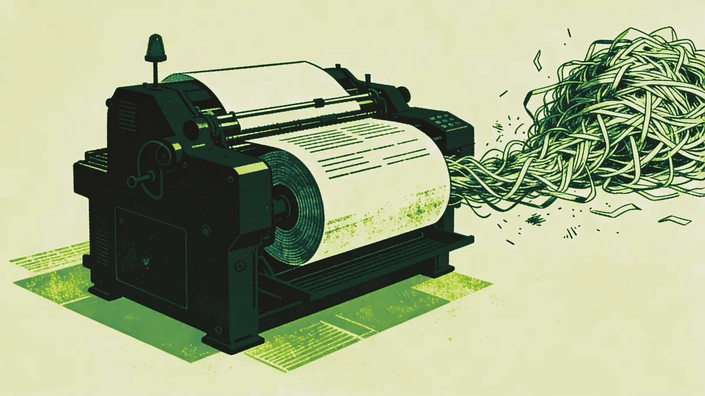

Every B2B marketing team is somewhere on the AI adoption curve. Most are further behind than they think, but not in the way they assume.

The conversation about AI in marketing has become almost impossible to have clearly. On one side, the hype machine is relentless: AI will replace your team, automate everything, generate infinite content at zero cost. On the other, a skepticism that's understandable but increasingly hard to justify: "we tried ChatGPT and the output was generic."

Both positions miss what's happening. AI is not replacing B2B marketing teams, but it is already separating teams that know how to use it from those that don't, and that gap is widening faster than most marketing leaders want to admit.

## What's working right now

The AI use cases generating real, measurable value in B2B marketing today are rarely the flashy ones.

In research and synthesis, AI can process large volumes of information (competitor analysis, customer interview transcripts, market reports, sales call recordings) and extract structured insight, so work that took a week now takes an afternoon. The output isn't perfect, but it's a good first draft of something that would otherwise have been a blank page.

Content at scale works too, as long as it has guardrails. "Generate a blog post" almost never produces anything worth publishing without significant human editing. "Given this brief, this audience, and these three existing examples of our tone, generate five variations of this email subject line" does work, and the guardrails are the reason: specific inputs, specific constraints, and human judgment at the end.

Personalization infrastructure is still emerging, but the early results are significant. B2B buying committees are typically 6 to 10 people, and each of them cares about different things. For the first time, AI makes it feasible to create personalized versions of content for different stakeholders at scale, without a team of 20 writers.

For most marketing teams, though, the biggest change is the speed of the loop. Testing an idea, getting feedback, and iterating now takes hours instead of days, which is freeing for teams that had more ideas than production time.

## What isn't working

Autonomous content production, the dream of "set it and run" AI content, hasn't arrived for B2B yet. The output lacks the specific expertise, industry nuance, and honest opinion that make B2B content credible with a senior buyer. AI can help you produce content faster, but it can't yet do that without a knowledgeable human in the loop.

In lead scoring and intent data, a lot of money is going into AI-powered intent platforms. Some of it is well spent. Most of it isn't, because the signal quality is poor, the integration with sales workflows is weak, and the teams using it don't have the operational discipline to act on signals quickly enough to make the data meaningful.

AI-generated personalization fails when there's no strategy behind it. Personalizing at scale is only valuable if you have something worth personalizing, and teams that have jumped to AI-powered personalization without a clear segmentation strategy and differentiated messaging for each segment are just automating noise.

## The hybrid model

We find it most useful to think of AI as an amplifier of human judgment in B2B marketing.

A marketer with good judgment, deep customer understanding, and a clear strategic framework becomes dramatically more effective with AI tools. A marketer without those foundations becomes dramatically more efficient at producing the wrong things.

That's why the companies winning with AI in B2B marketing right now are not the ones that have deployed the most tools. They're the ones that have been most deliberate about where human expertise is irreplaceable, and where AI can remove the friction without removing the quality.

In practice, your best strategist spends less time on research and production and more on the decisions that require their specific knowledge and judgment, while AI handles the legwork.

## What to do next quarter

For a B2B marketing leader trying to make this practical, we'd suggest five things.

**Audit your current time spend.** Before buying any tools, understand where your team's time goes. In our experience, 40-60% of B2B marketing team time is spent on tasks that AI can handle well, and those tasks are your opportunity: research, first drafts, data compilation, reporting, briefing documents.

**Start with one workflow.** Pick the single most time-consuming repeatable task your team does (content briefs, competitive analysis, email sequences, whatever it is) and build a proper AI workflow around it. One workflow done well teaches you more than five done badly.

**Invest in prompting as a skill.** The quality gap between teams using AI effectively and teams using it poorly is almost entirely explained by how they interact with the tools. Prompting can be taught, and it's worth the investment.

**Don't automate what you haven't mastered manually.** If your messaging isn't working, AI-powered distribution will just get a weak message to more people. If your lead qualification process is broken, AI-powered scoring will make it faster and still broken. Fix the fundamentals before you automate them.

**Build the governance now.** AI-generated content creates legal, brand, and factual accuracy risks that most B2B marketing teams aren't managing properly yet. Put a review process in place before you scale.

## The forecast

AI will change B2B marketing significantly over the next three years. The teams experimenting thoughtfully now, building real capability in specific areas, will have a meaningful advantage.

The teams that are waiting for it to "settle down" before engaging are already behind. The technology is not going to become simpler or less relevant, and the learning curve only gets steeper the longer you wait.

Start small and specific, keep human judgment in the loop, and measure what changes. It's a modest approach, but in a space this full of hype and confusion, it's the one that works.

---

*We help B2B marketing teams build AI and hybrid marketing strategies that are grounded in business reality. If you're trying to work out where to start, that's exactly the kind of conversation we're good at.*
