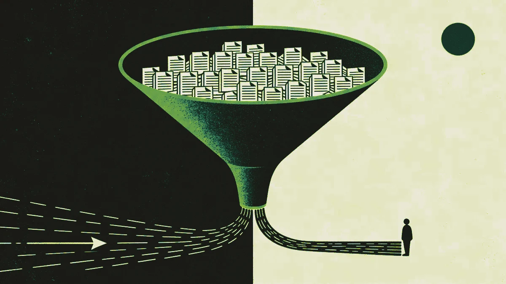

When the client came to us, they weren't losing clients to a competitor. They were losing them to the wait.

A business owner calls looking for commercial liability coverage and gets routed to a queue. A specialist in Manila picks up, gathers the information, runs the numbers and calls back. By the time the quote lands, forty minutes have passed on a good day. On a bad day, the business owner has already moved on.

The team was performing fine, but the process wasn't built for the volume or the speed the market now expects.

## What the operation looked like before

The client operates in a competitive segment of the US commercial insurance market: SMB and mid-market businesses looking for general liability, workers' compensation and commercial property coverage. Deal sizes range from a few thousand dollars to north of $80,000 in annual premium.

Their quoting operation was built on a model that worked well ten years ago. Inbound requests came in by phone and web form, and a team of trained specialists based in the Philippines handled the triage and initial quoting: gathering business details, running the request through carrier portals and returning a quote to the prospect.

The model had real strengths. The team was experienced, the quality of the quotes was high, and the specialists knew the product well. But it had two structural problems that compounded as volume grew.

The first problem was speed: the average time from initial contact to delivered quote was between 25 and 40 minutes. For a business owner with three tabs open comparing providers, that window is too long.

The second was coverage. The Manila team worked a defined shift window, so quote requests that came in outside those hours went into a queue and waited. In a market where competitors increasingly offer instant or near-instant responses, that gap was becoming visible.

## The decision not to replace the team

The easiest misread of this project is to frame it as automation replacing people. That isn't what happened, and it was never the goal.

The client's specialist team had something no model can replicate in the short term: deep product knowledge, the ability to handle complex accounts, and the relationship skills to close a nervous buyer. Replacing them would have been both operationally risky and commercially shortsighted.

The problem was that the team spent a disproportionate share of its time on straightforward requests that followed a predictable pattern: standard industry codes, clean business histories, coverage needs that mapped neatly to existing products. Requests like these needed a fast, accurate first pass, which doesn't take a specialist.

The shift we proposed was about where that human expertise gets applied.

## What we built

The solution was a two-layer quoting architecture: an AI agent handles intake and first-pass quoting, and human specialists handle everything that involves judgment, negotiation or complexity.

When a request comes in, whether by web form, chat widget or phone (converted to structured input), the agent gathers the core business information, runs a qualification check against the carrier criteria and produces a first-pass quote for eligible accounts. For standard requests, this takes under seven minutes from first contact to delivered quote. The system runs around the clock, seven days a week.

The agent doesn't pretend to be human and is transparent about what it is. It's also explicitly designed to hand off cleanly when a request falls outside its parameters: complex coverage structures, high-risk industry codes, accounts with claims history, or any situation where the prospect signals they want to speak with someone.

Those handoffs go directly to a specialist with full context already captured, so the specialist picks up a warm, pre-qualified account instead of starting from scratch.

## What changed in the numbers

Twelve months after full deployment, quote response time for standard requests had dropped from an average of 31 minutes to an average of 7 minutes, a 77% reduction. For requests that come in outside business hours, response time went from the next available shift to under 10 minutes, regardless of the time of day.

The AI layer now handles first-pass quoting end to end for 64% of all inbound requests. The remaining 36% get escalated to specialists, but they arrive with the intake work already done.

The specialist team's capacity profile changed significantly. Before the project, standard intake and first-pass quoting absorbed roughly 70% of specialist time. Afterward, that share dropped to under 25%, and the reclaimed time went to complex accounts and to active follow-up on mid-market opportunities where the premium value justified deeper attention.

Conversion on complex accounts, the segment above $30,000 in annual premium, improved by 23% over the same period. The team attributes this directly to having more time to work those accounts instead of processing volume.

The cost comparison with a 24/7 human staffing model is instructive, even though cost was never the primary driver of the decision. Running equivalent coverage with human agents across all US time zones and states would have required a significant expansion of the Manila team plus dedicated coordination overhead. The AI infrastructure runs at a fraction of that cost for the volume it handles, and the investment essentially paid for itself within the first eight months.

## What did not change

The specialists are still there, and their remit got better. The complex accounts, the relationship-dependent renewals and the buyers who want to talk through their risk profile with someone who understands it are still handled by people. In several ways, the AI layer improved the conditions for applying their expertise.

Customer satisfaction scores for the specialist-handled segment held steady through the transition and have since improved modestly. The team links this to shorter wait times on escalations and better-prepared handoffs.

## What this kind of project actually requires

This wasn't a technology implementation. It was an operational redesign that happened to use AI as one of its components.

The work before the build was significant: mapping the decision logic experienced specialists actually use when triaging a request, defining the escalation criteria clearly enough for the AI to apply them consistently, and building the handoff mechanics so context traveled cleanly between layers.

Getting that logic right took longer than the technical implementation, and it's the reason the system works. An AI agent that doesn't accurately reflect how your best people make decisions will produce inconsistent output that erodes trust faster than it builds efficiency.

For the client, the result was a quoting operation that's faster for the customer and more focused for the team. It's also structurally better equipped for growth without a proportional increase in headcount.

---

If your sales or service operation is running into similar constraints (capacity spread too thin, speed expectations the current model can't meet), the conversation usually starts with the question that points to the leverage: where is your team spending time on work that doesn't require their expertise?
