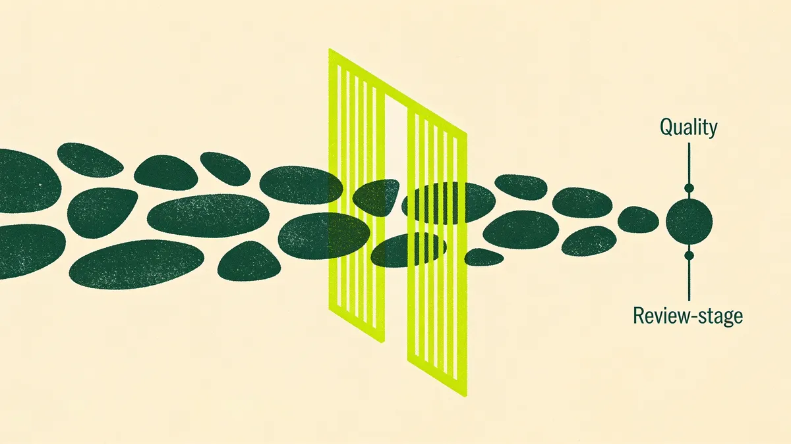

Pregunta a los equipos de marketing B2B si usan IA y casi todos te dirán que sí. Aprieta un poco más y la respuesta empieza a flojear. Casi siempre, "usamos IA" quiere decir que alguien del equipo abre una ventana de chat, escribe un prompt, recibe un párrafo decente y lo pega en un doc. Al día siguiente lo vuelve a hacer, desde cero, sin recordar nada de lo que funcionó la última vez. Eso es un truco de feria: impresiona en la reunión y el viernes ya no vale nada.

Casi todo el valor está en la distancia que separa ese prompt de un workflow de verdad, y la mayoría de los equipos nunca la recorre.

## El modelo no es la ventaja. Todos tienen el mismo.

El modelo que usas es, más o menos, el mismo que usa tu competencia. Los dos tenéis la misma capacidad de base y las mismas herramientas públicas por la misma suscripción mensual. Si toda tu estrategia de IA es "tenemos acceso a un buen modelo", no tienes estrategia, porque ese acceso lo tiene todo el mundo.

La ventaja sale de lo que construyes alrededor del modelo: los inputs que le das, los pasos que encadenas, los controles que pones y el punto en el que entra una persona. Esa parte nadie te la puede copiar, porque depende de cómo trabaja tu equipo. Si el modelo es el motor, el workflow es el coche, y nadie gana una carrera con un motor perfecto tirado en el suelo del garaje.

Así que lo que conviene preguntarse es si has convertido algo de todo esto en un proceso que funcione igual cada vez. La mayoría no lo ha hecho y se ha quedado en el prompt.

## La diferencia entre un prompt y un pipeline

Un prompt es una sola pulsación manual. Lo escribes, coges el resultado y a otra cosa. Vive en tu cabeza y en tu historial de chat. Nadie más lo puede ejecutar, y ni siquiera tú lo ejecutas dos veces igual, porque lo formularás de forma un poco distinta y obtendrás un resultado un poco distinto. Nunca mejora; simplemente se repite, una y otra vez.

Un pipeline es un proceso encadenado y repetible. Tiene inputs definidos, una secuencia de pasos, un control de calidad y un checkpoint humano. Funciona igual lo ejecutes tú o la persona que acabas de contratar, en su segunda semana. Y, sobre todo, va acumulando mejoras: cada vez que lo ejecutas puedes afinar el input, pulir un paso o cazar un modo de fallo que antes no veías. El prompt empieza de cero cada vez; el pipeline sale mejor cada vez.

El trabajo, entonces, consiste en coger los buenos prompts que ya tienes y convertirlos en pipelines que sigan funcionando cuando ya no recuerdes qué escribiste.

## Cinco workflows que un equipo pequeño puede lanzar este trimestre

Para ninguno hace falta un equipo de datos ni un gran presupuesto, y ninguno exige una hoja de ruta de seis meses. Son el tipo de cosa que un equipo de marketing de dos a cinco personas puede montar en un trimestre.

**De investigación a brief.** Le das un tema, un ICP objetivo y un par de enlaces de fuente. El workflow extrae las ideas principales, las cruza con tu posicionamiento y produce un brief de contenido estructurado: ángulo, opciones de titular, el argumento y los proof points que hay que reunir. Lo que antes era una tarde saltando entre pestañas se convierte en un primer borrador del razonamiento, que luego alguien del equipo afina.

**Reutilización de contenido, de una pieza a muchas.** Pongamos que tienes un buen webinar, un post largo potente o una conversación con un cliente. El workflow toma esa única fuente y produce la versión de LinkedIn, la sección de la newsletter, los hooks de formato corto y el snippet de nurturing por email, todos con la misma sustancia adaptada a cada canal. Aquí es donde un equipo pequeño nota más la palanca, porque su cuello de botella son las horas que cuesta adaptar una idea a ocho sitios.

**Primer borrador, luego edición humana.** El modelo escribe la primera versión a partir de un brief ajustado y de tu guía de voz. Después, una persona hace lo que las personas hacen bien: matar las frases genéricas, añadir ese detalle concreto que solo tú conoces y decidir si el argumento es siquiera cierto. El borrador nunca pasa de punto de partida.

**Personalización a escala para outbound.** En lugar del mismo email en frío a 500 personas, el workflow toma una lista de cuentas y redacta una línea de apertura relevante para cada cuenta, basada en una señal real. Alguien revisa el lote, descarta las que no dan en el clavo y envía. El resultado es mucho más concreto que un "Hola {Nombre}", y a un volumen al que nadie llegaría a mano.

**Reporting y automatización de ops.** Los números semanales que alguien odia montar cada lunes: el workflow los extrae, los estructura y redacta un resumen en lenguaje llano de qué se movió y por qué. Una persona lo revisa con sentido común y añade el criterio, y el equipo recupera la mañana del lunes.

## Cómo es un pipeline de verdad, de principio a fin

Coge la reutilización de contenido. El contrato de entrada es explícito: una pieza original de más de 800 palabras, más una nota de una línea sobre el público objetivo y el único mensaje con el que quieres abrir. Sin fuente, no se ejecuta. Ese contrato es lo que impide que entre basura en el sistema, porque un input vago produce siempre un output vago, y ningún prompt ingenioso te salva de un brief malo.

Paso uno: el workflow extrae el argumento central y los tres o cuatro proof points. Paso dos: redacta cada formato de salida siguiendo la plantilla que has definido para ese canal, que le da mucho más con lo que trabajar que un genérico "escribe un post de LinkedIn". Paso tres: marca todo lo que no ha podido sacar del original, para que sepas qué es inferencia y qué está fundamentado. Y ahí se detiene: no publica nada, le entrega a alguien del equipo un lote limpio con las marcas puestas.

Esa persona edita y aprueba. Lo que convierte esto en un pipeline es que cada edición te enseña algo: el arreglo que repites se convierte en una regla de la plantilla, y el fallo que cazas una y otra vez pasa a ser un paso más del control de calidad. A los tres meses, el workflow produce un output que necesita la mitad de edición que el primer día.

## Qué separa un pipeline del slop

Que un workflow produzca trabajo real o basura verosímil depende de cuatro cosas que se construyen alrededor del prompt.

La primera es un contrato de entrada claro. Si el workflow acepta cualquier cosa, produce cualquier cosa, así que define cómo es un input válido y rechaza lo que no encaje. Casi todo el output malo de IA empieza siendo un input malo.

También necesitas un humano en el bucle, y en el punto justo, que es donde se ejerce el criterio: ¿es cierto?, ¿encaja con la marca?, ¿se sostiene el argumento? Dar el visto bueno al final a un lote que nadie ha leído con calma no responde a ninguna de las tres. El modelo es rápido, va sobrado de seguridad y, de vez en cuando, se equivoca con mucha elocuencia. El humano es quien sabe distinguirlo.

La tercera es un control de calidad, un checklist que el output tiene que superar antes de salir. Las afirmaciones llevan fuente, no hay estadísticas inventadas, la voz encaja y la pieza dice algo que un competidor no podría haber dicho. Lo que suspende el checklist vuelve para otra pasada.

La última es el versionado: guardas el workflow además del output, así que cuando algo se rompe puedes ver qué cambió, y cuando algo funciona puedes reutilizarlo. Un pipeline que no puedes inspeccionar es un truco de feria, solo que más lento.

Deja siempre a un humano en el paso del criterio. Automatiza el ensamblaje, el reformateo, el primer borrador y el salto entre pestañas, pero nunca la decisión de si algo es cierto, encaja con la marca o merece enviarse. De esa decisión depende que el workflow vaya a mejor o que acabes haciendo el ridículo.

## Empieza por la fontanería

No existe ningún modelo secreto. Los equipos que van por delante con la IA ahora mismo son los que hicieron el trabajo poco glamuroso de convertir un puñado de buenos prompts en un puñado de pipelines fiables, con contratos, controles y un humano donde hace falta.

Un equipo pequeño puede hacerlo este mismo trimestre, sin necesidad de escala. Elige un workflow, define el input, monta los pasos, pon el control y ejecútalo las veces suficientes para que las mejoras empiecen a acumularse. Luego elige el siguiente.

---

*En The B2B Tinkerers ayudamos a equipos B2B a pasar del truco de feria a pipelines que sacan trabajo de verdad. Si ya te has cansado de hablar de IA y quieres ponerla a funcionar, mira cómo [enfocamos la estrategia de IA](/es/services/ai-strategy) o [hablemos](#contact).*
