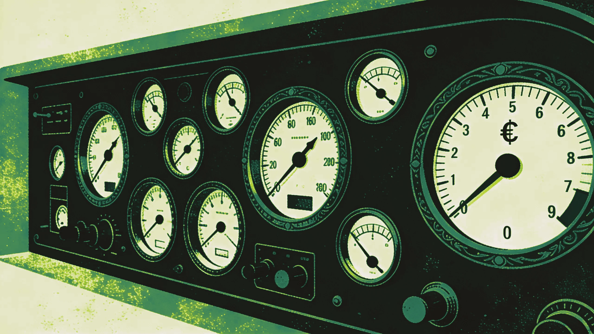
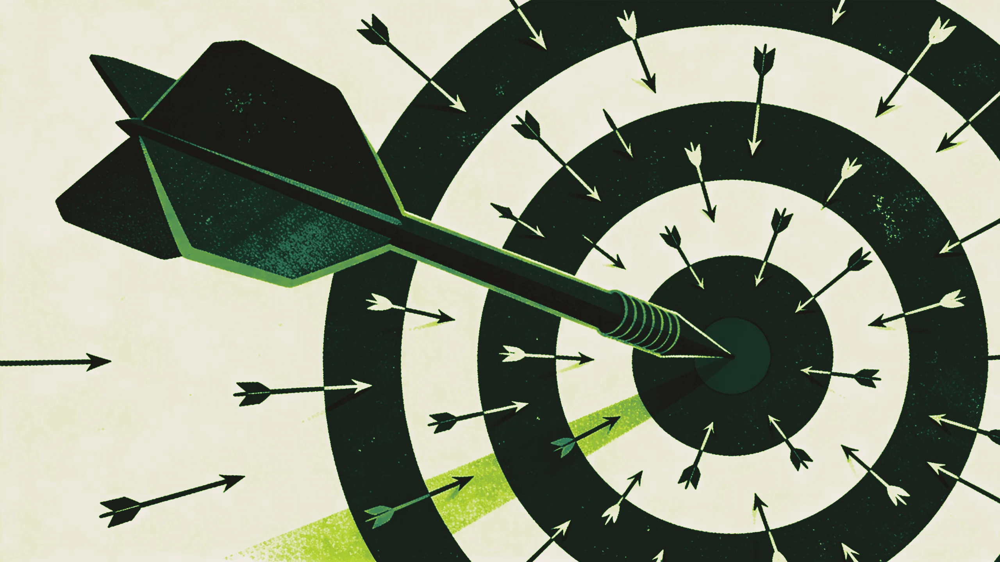

B2B marketing teams are producing more content than ever. They're running campaigns across more channels, tracking more dashboards, attending more stand-ups, and filing more reports. Calendars are packed and Slack never sleeps.

And yet, when the CFO asks the simple question, *"What did marketing contribute to revenue this quarter?"*, the room goes quiet.

It's a focus problem, and if you're running or working inside a B2B marketing function, there's a good chance you're caught in it right now without realizing it.

## The busy trap: when activity feels like progress

Say your team published 12 blog posts last month, sent out 8 email campaigns, ran paid ads on LinkedIn and Google, posted daily on social media, and produced a webinar. You hit your content calendar targets and the dashboards are green. Impressions are up, email open rates look decent, and you've got a healthy stack of MQLs coming through.

How many of those MQLs became pipeline? How many turned into conversations that sales cared about, and how many led to closed revenue?

If you can't answer that with confidence, you're not alone. According to a 2025 study by 6sense, MQLs remain the dominant success metric in B2B marketing, yet revenue-focused outcomes like closed-won deals or influenced pipeline are tracked far less consistently, so most teams end up optimizing for the wrong things.

Content marketing shows a similar picture. Research from the Content Marketing Institute found that while 87% of B2B marketers say content helped create brand awareness, only 49% report it helped generate sales or revenue. That's a massive gap between effort and outcome, and a lot of marketing budget disappears into it.

## Why being busy doesn't mean being effective

Most B2B marketing teams confuse outputs with outcomes. Outputs are things you produce: posts, emails, campaigns, events. You can count them, schedule them, and report on them, and they feel productive because they're visible and easy to measure.

Outcomes are what those outputs achieve: pipeline generated, deals accelerated, revenue influenced, customer retention improved. They're harder to measure, take longer to materialize, and often require uncomfortable conversations about what's working.

When teams are under pressure to "show marketing is doing something," the natural instinct is to do more: more content and more campaigns, in more channels. But doing more of the wrong things faster leaves the pipeline exactly where it was.

There's a name for this in B2B: *the activity trap*, where the pace of execution becomes a substitute for strategic thinking. You're so busy shipping that you never stop to ask whether what you're shipping matters.

## The metrics that lie to you

Vanity metrics are what keep the busy trap running. Click-through rates, impressions, email open rates, social media engagement, and lead counts all have their place: they can help you diagnose creative performance or understand audience behavior. But when they become your primary success indicators, you're building a marketing function on sand.

A $50 (€45) cost per lead means nothing if those leads never convert to pipeline. A viral LinkedIn post feels great until you realize none of the engagement came from your ICP, and high email open rates stop being encouraging once you notice your reply rate is zero.

Gartner's 2025 data shows that CMO budgets have remained flat at 7.7% of company revenue. When marketing can't demonstrate clear connections to business outcomes, it struggles to secure the investment it needs. The teams that get their budgets cut aren't the ones doing nothing. They're the ones that can't prove their work matters.

## What impact looks like in practice

Impactful B2B marketing starts with one question, asked about everything the team does: *Is this activity connected to revenue?*

Not every piece of content needs a direct CTA to book a demo. Brand building, thought leadership, and awareness all matter, especially in B2B, where sales cycles are long and buying committees involve 9 to 12 people on average. But even brand activities should have a clear hypothesis about how they contribute to the business over time.

That question leads to four shifts in where you put your attention.

Start with pipeline: instead of asking "How many leads did we generate?", ask "How much pipeline did marketing source or influence?" That single shift changes what you prioritize, how you allocate budget, and what you optimize for.

Then look at sales cycle velocity, because marketing that helps deals close faster has a direct effect on revenue. Reducing your average sales cycle from 180 to 150 days closes deals sooner, and it also accelerates cash flow, reduces acquisition costs, and lets your sales team handle more volume.

Measure how deeply the right accounts engage. In ABM and demand gen alike, the number of people who saw your ad says little about whether the right accounts are engaging with your content and moving through the buying journey.

Finally, don't stop at new logos. Some of the highest-ROI marketing happens post-sale: upsell campaigns, community building, customer education, and retention programs. Yet most B2B teams put the vast majority of their energy into top-of-funnel acquisition.

## Five ideas to shift from busy to impactful

If you recognized your own team in all of that, there are five places to start.

**1. Kill your content calendar (and rebuild it with intent).** Stop publishing content because "we need to post three times a week." Instead, map every piece of content to a specific stage in the buyer's journey and a measurable business outcome. If you can't articulate who the content is for and what action it should drive, don't create it. One deeply researched, strategic piece per month will outperform twelve filler articles.

**2. Adopt a "revenue-back" planning model.** Start with revenue targets and work backwards. How much pipeline do you need? How many qualified opportunities does that require? What conversion rates apply at each funnel stage? The math will tell you where to focus and, just as importantly, where to stop spending time.

**3. Create a "stop doing" list.** This is the hardest one, and possibly the most powerful. Audit every recurring marketing activity: reports, campaigns, meetings, channels. For each one, ask: "If we stopped doing this tomorrow, would it impact pipeline or revenue within 90 days?" If the answer is no, or you're not sure, put it on probation. It usually frees up more bandwidth than you'd expect.

**4. Align your measurement to CFO language.** Your CMO might care about MQLs, but your CFO cares about customer acquisition cost, pipeline velocity, and marketing-attributed revenue. If your reporting doesn't speak in financial terms, you're having the wrong conversation. Keep the marketing metrics, but connect them to the outcomes that determine your budget.

**5. Pick one or two bets and go deep.** The temptation in B2B is to spread thin: a little LinkedIn, some Google Ads, a bit of content, a webinar here and there. The result is mediocrity across the board. Identify the one or two channels or strategies where you have the highest probability of impact, and master them before you expand.

## The courage to do less

Impactful marketing means telling your stakeholders that the content calendar will be lighter because you're publishing fewer, better pieces. It means pausing campaigns that look good in the dashboard but aren't generating pipeline, and sitting with the discomfort of fewer visible outputs while you build the foundations for real results.

The B2B teams that win do the right things consistently and can prove it. The marketing industry has spent years celebrating hustle, productivity, and volume, and all that busyness works against impact. With budgets flat and executive patience thin, only the marketing that can show what it did for revenue survives.

So take an honest look at your calendar this week. How much of what you're doing is driving the business forward? And what would change if you gave yourself permission to stop everything that isn't?

---

*At The B2B Tinkerers, we help B2B companies build marketing strategies that drive revenue. If your marketing feels busy but not impactful, [let's talk](#contact).*
