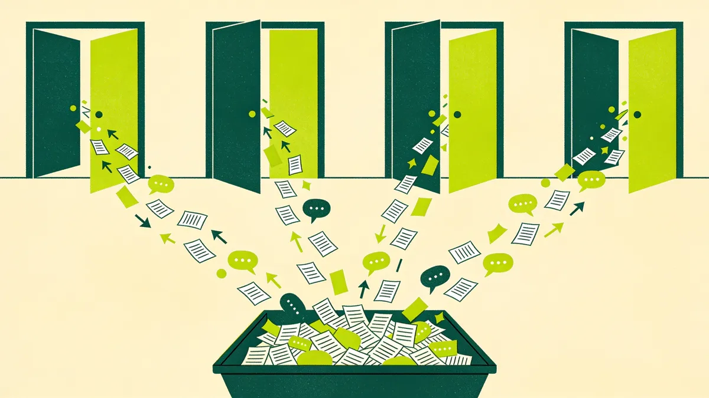

It's 9:14 on a Monday. Sales just pinged you for a one-pager they need "by end of day" for a call that, apparently, is happening tomorrow. The CEO wants a LinkedIn post about an industry award before lunch. There's an event next week and the booth graphics still aren't approved. And the campaign you actually planned for this sprint, the one tied to the quarter's pipeline target, slips again, for the third week running.

That's firefighting mode, and for most B2B marketing teams it's the permanent operating state, so normal that nobody questions it anymore. Everyone is busy and stressed and the team looks productive, but almost none of the work moves the business forward.

When you're in this state, the instinct is to assume you need more people. You probably don't, or at least not yet.

## Firefighting isn't a workload problem. It's an operating-system problem.

When a team is drowning, "we need another headcount" feels like the obvious answer. But drop a new hire into a team with no system for how work arrives, gets prioritized, and gets done, and all you get is a second firefighter running to the same fires.

What's breaking your team is that nothing controls the volume of requests. Most marketing functions have a content strategy, a brand guide, maybe a campaign calendar. What they almost never have is an operating system: the boring machinery that decides what the team works on, in what order, and what it deliberately doesn't do.

Without one, every request is treated as an emergency and handled in order of whoever shouted loudest. At that point your team is a queue with no bouncer.

## The three doors your work comes through (and why they're all unlocked)

Look at how work reaches your team this week. I'd bet it comes through at least three doors, all of them wide open.

There's the Slack DM: a colleague messages someone on your team directly, and now that person has a task nobody else can see. There's the hallway ask, or its remote equivalent, the "quick favor" dropped in a meeting that turns into six hours of design work. Then there's the exec override, where leadership goes straight to a team member and everything reshuffles because the request came from someone senior.

Each of these bypasses any notion of priority. The work enters the system without being weighed against anything and starts eating capacity out of sight. Nobody is deciding *this matters more than that*. The requests arrive, and your team absorbs all of them.

You can't prioritize what you can't see, and right now half your team's workload is invisible, scattered across DMs and side conversations, never landing on a shared surface where anyone could make a trade-off.

## Why everything is "urgent" and nothing is important

When there's no framework for priority, one rule takes over by default: the loudest stakeholder wins. Urgency turns into a social negotiation. The person who pushes hardest, or sits highest on the org chart, gets their work done first, whatever it's worth to the company.

The result is a team that's permanently reactive. Everything is labeled P1, which is the same as saying nothing is. Your two or three real priorities, the initiatives that would move pipeline this quarter, get buried under a landslide of small, loud "urgent" tasks that each felt reasonable in isolation.

The strategic work never has a deadline screaming at it. Nobody angry in Slack is waiting on the brand project, the positioning refresh, or the nurture sequence that would compound over time. That work is important and never urgent, so it's always what gets bumped.

## The hidden tax nobody puts on the invoice

The cost of all this that never shows up in a report is context switching, and it's brutal.

Every time someone on your team drops the campaign to make the "quick" one-pager, then jumps to the CEO's LinkedIn post, then goes back to the campaign, they pay a tax. Research from the American Psychological Association found that shifting between tasks can cost as much as 40% of someone's productive time. That time is pure loss, burned in the switching itself: reloading context and remembering where you were.

So a team that looks fully utilized, with everyone busy and everyone shipping, might be running at a fraction of its real capacity even though people are working hard, because the system forces them to work in fragments.

A concept from software teams helps here: work-in-progress limits. The idea is counterintuitive but proven. When you cap how many things can be "in flight" at once and make the team finish before it starts something new, throughput goes *up*. With less in progress, each piece of work gets done faster and with fewer errors, and fewer half-finished projects sit rotting in the backlog.

## Building the operating system

The way out is a system, and you can build a minimum viable version before you buy any new tool.

**Build one front door.** Every request, no exceptions, goes to a single intake: one form, one board, one channel. If it didn't come through the front door, it doesn't exist. That one move makes the invisible workload visible for the first time, and everything else depends on it.

**Run a weekly triage.** Once a week, the designated owner of prioritization looks at everything in the intake and decides what's in, what's out, and in what order. They apply one consistent lens, no matter who is shouting loudest: does this connect to a business outcome we care about this quarter?

**Set WIP limits.** Decide how many projects the team can carry at once, and hold the line. When something new that matters comes in, something else has to come out. That makes the trade-off explicit, so nobody can pile new work on without saying what it replaces.

**Make the board visible.** Put the work, and the queue, on a surface everyone can see. When a stakeholder asks for something urgent, show them the board and ask what they'd like to bump. Nobody has to hear a no, and nine times out of ten "urgent" evaporates the moment there's a visible cost attached to it.

**Protect a capacity buffer.** Real fires do happen: a genuine PR issue, a product launch that moves up. Don't plan the team to 100%. Leave room so a real emergency doesn't detonate the entire plan.

## Why a new tool won't fix it

Plenty of teams assume the answer is buying Asana, or Monday, or Jira, and that the chaos will then sort itself out. But a backlog that never gets groomed fills up with work nobody will ever do, however nicely the tool displays it. Without a ritual around it, the tool just sits there.

What changes the team is *cadence*: a weekly triage that actually takes place, a WIP limit somebody enforces, and a front door that even leadership respects. The discipline lives in recurring human decisions. You could run all of this on a whiteboard and a standing 30-minute Monday meeting and outperform a team with a $50,000 (€45,000) enterprise platform and no discipline.

The best B2B marketing teams I've seen are also the calmest, and it isn't because they have less work. They decided, in advance and out loud, what they would and wouldn't do, and they swapped the adrenaline of constant firefighting for the slower payoff of finishing what matters.

Your team is capable of that. Before you blame talent or ask for more headcount, look at the system. It's the more likely problem, and systems, unlike fires, are something you can build.

---

*At The B2B Tinkerers, we help B2B marketing teams trade chaos for a system that lets them ship the work that matters. If your team feels permanently reactive, [let's talk](#contact).*
