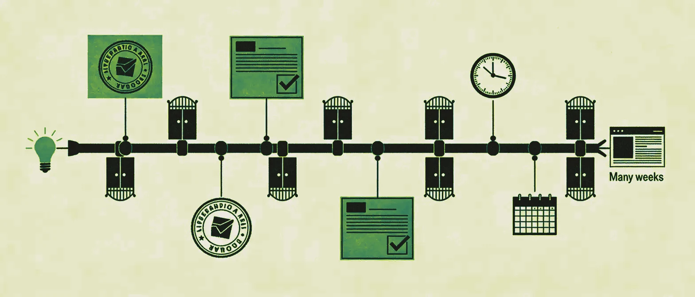

A B2B marketing team wants to publish a new landing page, and the usual routine kicks in. Someone opens a ticket and waits. The agency asks for a brief, a sprint gets scheduled, and two weeks later the page goes live. By then, the campaign it was built for has already moved on.

The platform blocking that process usually has a familiar name: Sitecore, Contentful Enterprise, Adobe Experience Manager, or whichever solution someone once justified to the management committee as "the scalable option for the long term."

The problem isn't that these platforms are bad. It's that for most B2B companies they're a brutally bad fit.

## The real cost nobody puts on the table

When a company decides to implement Sitecore, the initial budgets circulating in internal presentations rarely tell the full story.

The documented range for an enterprise Sitecore implementation runs from $220,000 (€200,000) at the low end, for straightforward deployments, to well over $1.1M (€1M) once advanced customization, CRM and ERP integrations, content migration and team training are factored in. The annual license alone averages around $77,000 (€70,000) and reaches $400,000 (€360,000) in high-traffic scenarios.

Then comes the operating cost: .NET specialists to maintain the platform, certified agencies for any meaningful change, and upgrade cycles that can freeze the site for weeks. An average marketing team can barely touch anything without outside help.

Contentful, usually pitched as the more agile, headless alternative, has its own uncomfortable accounting. The Premium plan starts at $60,000 a year at list price, and Enterprise configurations with multiple spaces and Platinum support can exceed $400,000 annually. On top of that come implementation costs (between $10,000 and $50,000 for mid-sized projects) and frontend development time, which none of those figures include.

The question nobody asks in the meeting room is what specific business objective justifies this spend over the alternatives available today.

## The scalability argument no longer works as an excuse

For years, the answer to that question was "scalability" and "integrations." Sitecore could manage 50 sites across multiple languages, personalize experiences in real time and integrate with any CRM on the market.

All of that was true, and for a multinational manufacturer with a presence in 30 countries and a digital team of 40 people, it probably still makes sense. But most of the B2B companies that bought these platforms between 2015 and 2022 looked nothing like that. They were mid-sized businesses with a marketing team of three to eight people, a mostly national or regional market, and a corporate website whose main job was to generate leads and publish content.

For that use case, spending between $220,000 (€200,000) and $1.1M (€1M) on implementation, plus tens of thousands a year on licenses and support, is a misjudgment that the inflated budgets of that era made possible. In 2026 that mistake is also competitively dangerous.

## What a modern marketing team actually needs from its website

Strip away the noise from vendor roadmaps and agency presentations, and the requirements of a B2B marketing team turn out to be surprisingly straightforward.

The team has to be able to publish new content (articles, landing pages, customer stories) without depending on a developer, and to create or edit lead capture forms when a campaign changes. When the positioning evolves, it needs to iterate on the homepage and product pages. It also needs to measure traffic, conversion and visitor behavior, and to connect the website to the CRM without a six-month integration project. A small team should be able to handle all of that in a matter of days.

None of these needs requires Sitecore. In fact, Sitecore often makes them harder, because the platform's complexity turns every change into a project.

## The alternatives worth considering in 2026

The market has matured considerably. There are now platforms that cover what B2B marketing teams need at a fraction of the cost, and that a team without specialist technical profiles can run.

**HubSpot Content Hub** is the most integrated option for teams already working in HubSpot. The website, CRM, forms, nurturing workflows and reporting all live in one place. Total cost of ownership is predictable and the learning curve manageable, and the marketing team can publish without opening a ticket. The main limitations are the dependence on the HubSpot ecosystem and some rigidity around advanced design control.

**Webflow** has changed what "design control without code" means. A designer, or a marketer with a visual instinct, can build complex pages, manage the CMS and publish to production without writing a single line of code. Initial builds typically go three to five times faster than on platforms like HubSpot. Its HubSpot integration for lead management works well, and its technical performance (SEO, Core Web Vitals, security) is ahead of most alternatives.

**Storyblok** is the headless option that doesn't sacrifice the marketing team's autonomy. Its visual editor lets you preview changes in real time without giving up the architectural flexibility of a decoupled CMS. For B2B companies operating in multiple markets that need to manage localized content at scale, it's a credible alternative to Contentful, with a much easier editing experience.

**Sanity** is worth a look for technically minded teams that want maximum flexibility in content modeling without paying Contentful's enterprise rates. Its core is open source, the hosted plans are affordable, and it integrates cleanly with any modern frontend, including Astro.

**Framer** is gaining traction among B2B SaaS teams that put design quality and speed of execution ahead of functional complexity. It isn't a solution for websites with complex content requirements. For a well-executed product website with an integrated blog, though, its time-to-market is hard to beat.

## The AI agent argument changes the calculation entirely

Platform evaluations from three years ago had no way to factor in one variable that, in 2026, nobody can ignore: AI agents have changed the relationship between team capacity and marketing output.

A B2B content team that used to need five people (strategist, writer, SEO specialist, designer, CMS manager) can now run with one or two, supported by specialized agents. One agent drafts the first version, another optimizes it for search and a third adapts the format for different channels. The person on the team directs, edits and publishes.

In that model, the website platform should be the last thing holding the team back. A website built on Sitecore or Contentful Enterprise, with its slow publishing cycles and dependence on outside technical profiles, can't keep up with the speed this kind of stack makes possible.

Platforms like HubSpot Content Hub, Webflow or Storyblok are designed, or can at least be configured, so that publishing is the fastest step in the whole process.

## The decision that needs to happen now

If your B2B company has a website on an enterprise platform you can't touch without calling an agency, you need to talk to your leadership about opportunity cost.

Every week a landing page spends waiting on a ticket, a sprint and an approval is market time you don't get back. The licenses and support you pay for every month, for capabilities you don't use, are budget that isn't going to pipeline.

A B2B website in 2026 has to be fast to operate, and there's no reason for it to be expensive to maintain. Technical complexity that doesn't translate into marketing speed or a better buying experience is a luxury almost no B2B company can afford.

Sitecore is an extraordinary platform for those who need it. The problem is that most of the companies that bought it probably didn't.

---

*Is your marketing team still waiting on IT or an agency to publish content? At The B2B Tinkerers, we help B2B teams audit their digital stack and migrate to leaner architectures without losing capability. Get in touch.*
